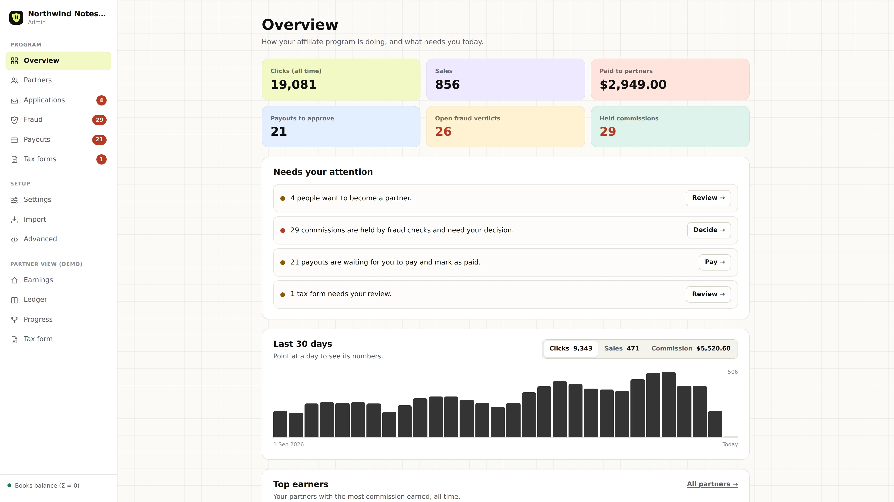
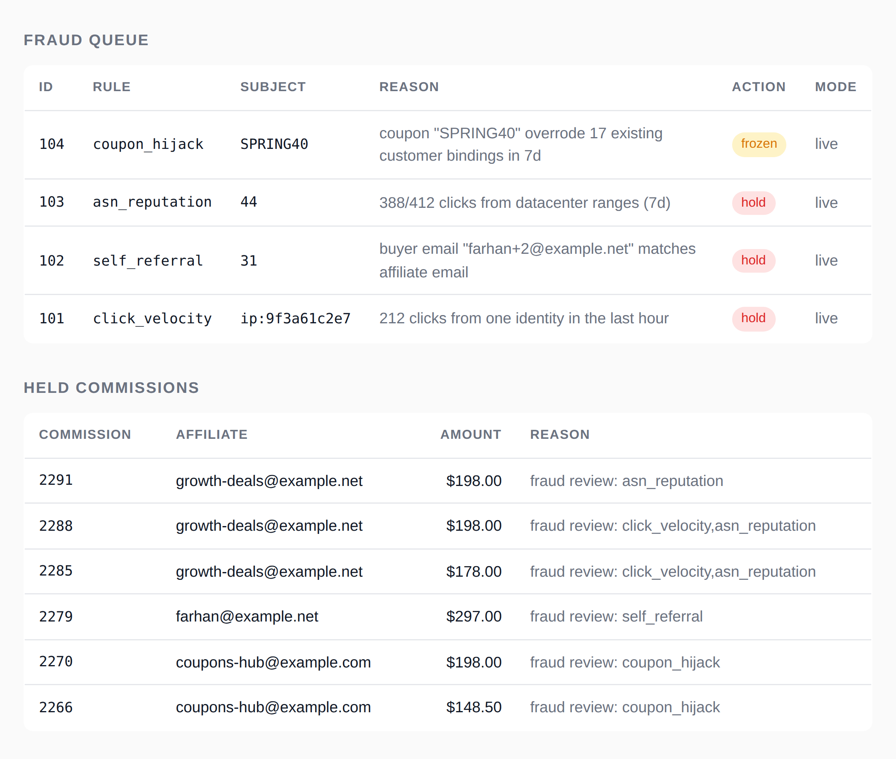
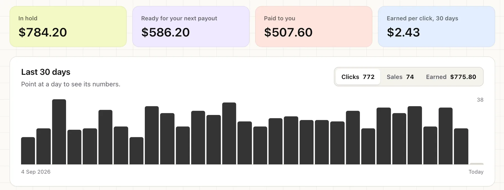

# AffiliateTracking: open source affiliate tracking software you host yourself

<p>
  <a href="LICENSE"></a>
  <a href="https://github.com/thebigasif/affiliate-tracking/releases/latest"></a>
  <a href="https://github.com/thebigasif/affiliate-tracking/pkgs/container/affiliate-tracking"></a>
  <a href="https://github.com/thebigasif/affiliate-tracking/stargazers"></a>
</p>

Run your own affiliate program on your own server. AffiliateTracking tracks partner clicks, credits sales from Stripe, Paddle and other billing tools, holds suspicious commissions before you pay them, and works out who to pay. It is a free, self-hosted alternative to Rewardful, FirstPromoter, Tapfiliate and Tolt, and it never takes a cut of your affiliate revenue.

[Website](https://affiliatetracking.co) · [Product tour](https://affiliatetracking.co/tour) · [Self-host guide](https://affiliatetracking.co/self-host) · [Docs](docs/) · [Discussions](https://github.com/thebigasif/affiliate-tracking/discussions)



## Why AffiliateTracking

- **Free and open source.** Every feature, unlimited affiliates and programs, no licence key and no revenue caps.
- **Your data stays with you.** Partners, clicks and payouts live in one database file on your server.
- **Fraud is held before you pay it.** [13 fraud rules](https://affiliatetracking.co/fraud) check each sale, and a flagged commission waits for your decision instead of being paid.
- **Books your affiliates can check.** A [double-entry ledger](https://affiliatetracking.co/ledger) records every commission, so each partner can see how their balance adds up.
- **Small and fast.** One program file with SQLite built in. In our load test it handled about 10,000 affiliate link redirects a second. Postgres is supported when you outgrow SQLite.

## Features

- Affiliate links, coupon codes and lifetime customer tracking
- Sales from [Stripe](https://affiliatetracking.co/integrations/stripe), [Paddle](https://affiliatetracking.co/integrations/paddle), [Chargebee](https://affiliatetracking.co/integrations/chargebee), [Lemon Squeezy](https://affiliatetracking.co/integrations/lemon-squeezy), [Polar](https://affiliatetracking.co/integrations/polar) and [Recurly](https://affiliatetracking.co/integrations/recurly)
- Recurring commissions, refunds and chargebacks handled automatically
- [Fraud checks](https://affiliatetracking.co/fraud) for self-referrals, click floods, coupon hijacking, bot and datacenter traffic, and more
- [Payouts](https://affiliatetracking.co/payouts) in batches, with PayPal and Wise bulk-pay files and tax form collection
- A branded affiliate portal on your own domain
- Multi-tier commissions, usage-based commissions and partner leaderboards
- A JSON API with scoped keys, plus an MCP server for AI assistants
- Import from your old tracker, with a dry run and one-command undo
- GDPR export and erasure, and optional IP anonymisation



## Quickstart

Download the binary for your system from [Releases](https://github.com/thebigasif/affiliate-tracking/releases/latest), or run the Docker image:

```bash
docker run -p 8080:8080 -v ae-data:/data ghcr.io/thebigasif/affiliate-tracking:latest
```

Or build it from source with Go:

```bash
go build -o affiliate-engine ./cmd/affiliate-engine
./affiliate-engine -listen :8080 -db sqlite:affiliate.db
```

The first run creates the database and a signing secret. Then create an admin API key and open `http://localhost:8080/admin`:

```bash
./affiliate-engine -db sqlite:affiliate.db keygen --scope admin --name ops
```

Next steps:

1. [Connect your site](docs/connect-your-site.md) with one script tag.
2. Add your billing tool's webhook secret. See [Configuration](docs/configuration.md).
3. Put it on a server with HTTPS. See [DEPLOY.md](DEPLOY.md) or the [self-host guide](https://affiliatetracking.co/self-host).

## Switching from another affiliate tool

AffiliateTracking imports affiliates, referral codes and customers from CSV exports. Old affiliate links keep working. A dry run shows conflicts and fraud signals before anything is written, and one command undoes an import. See [how to switch](docs/connect-your-site.md#connect-your-site-and-switch-from-another-tracker).

- [Rewardful alternative](https://affiliatetracking.co/rewardful-alternative)
- [FirstPromoter alternative](https://affiliatetracking.co/firstpromoter-alternative)
- [Tapfiliate alternative](https://affiliatetracking.co/tapfiliate-alternative)
- [Tolt alternative](https://affiliatetracking.co/tolt-alternative)
- [Compare all affiliate tracking tools](https://affiliatetracking.co/compare)



## Documentation

- [Connect your site and switch trackers](docs/connect-your-site.md)
- [Configuration](docs/configuration.md): every environment variable
- [HTTP endpoints](docs/api.md)
- [Payouts, tax forms and privacy](docs/payouts-and-privacy.md)
- [Architecture, performance and testing](docs/architecture.md)
- [Self-hosting and operations](DEPLOY.md)
- [Changelog](CHANGELOG.md)

## Hosted or Enterprise

Self-hosting is free. If you would rather we run it for you, with backups, upgrades, an SLA and migration help, see [Enterprise](https://affiliatetracking.co/pricing) or [contact us](https://affiliatetracking.co/contact).

The Shopify app and the [WordPress plugin](https://affiliatetracking.co/wordpress-plugin) are separate products and are not in this repository.

## Community

- Ask questions and share ideas in [Discussions](https://github.com/thebigasif/affiliate-tracking/discussions).
- Report bugs in [Issues](https://github.com/thebigasif/affiliate-tracking/issues). Report security problems privately, as [SECURITY.md](SECURITY.md) explains.
- Want to help? Start with an issue labelled [good first issue](https://github.com/thebigasif/affiliate-tracking/labels/good%20first%20issue).
- If AffiliateTracking is useful to you, star the repository so others can find it.

## License

GNU Affero General Public License, version 3: see [LICENSE](LICENSE), or the [plain-words version](https://affiliatetracking.co/license). Copyright (c) 2026 SAAS SEO AGENCY LLC.

Run it and change it freely for your own business. If you offer it to others as a hosted service, publish your changes under the same licence.
